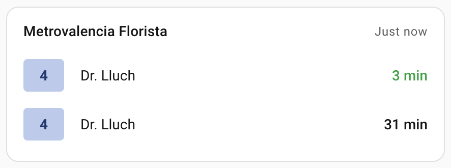
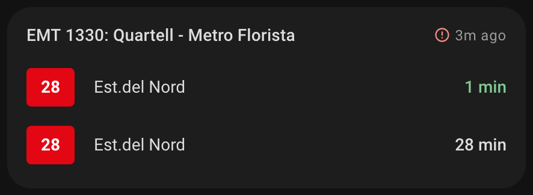
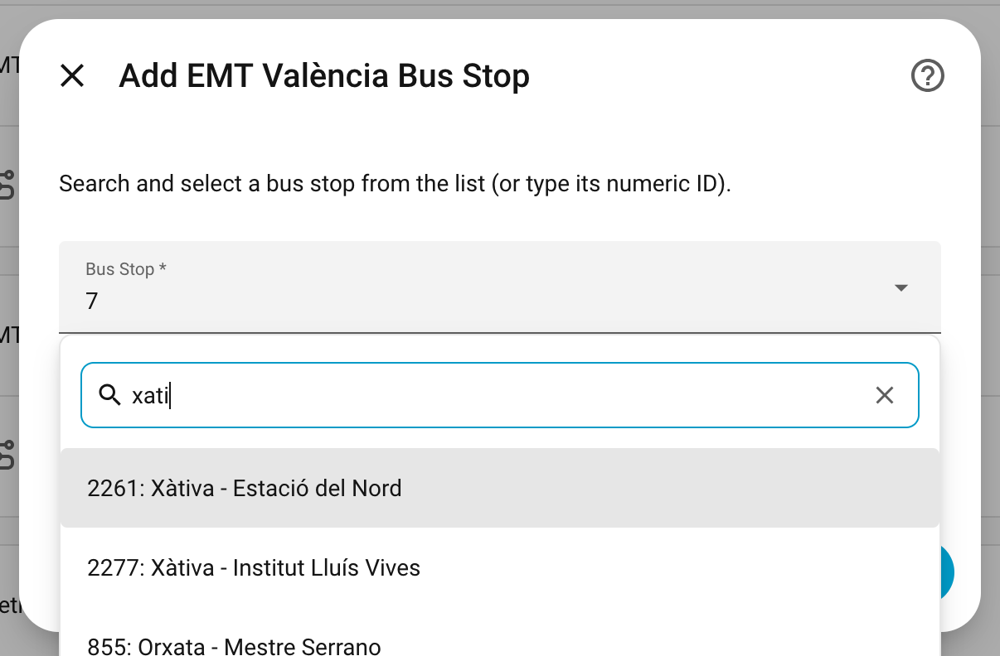
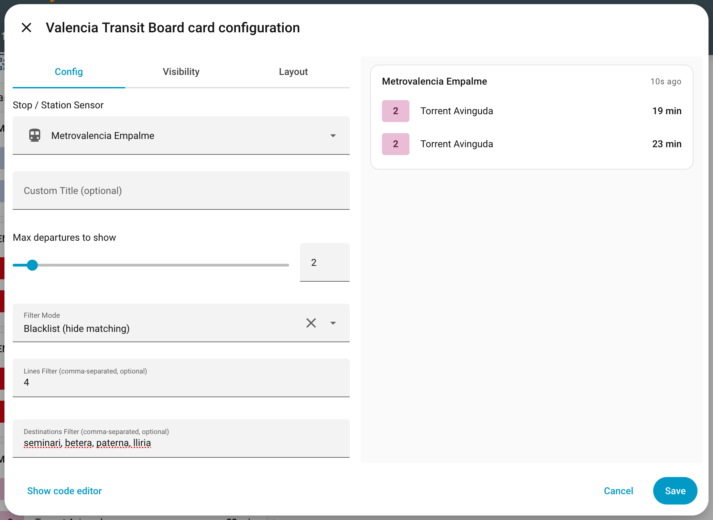

# Valencia Transport (EMT & Metrovalencia) for Home Assistant

[](https://github.com/justbearcause/vlc-transport-ha/actions/workflows/validate.yaml)
[](https://github.com/hacs/integration)
[](https://www.home-assistant.io/)
[](https://github.com/justbearcause/vlc-transport-ha/releases)
[](LICENSE)

A Home Assistant custom integration for real-time public transport departures in **València, Spain**, supporting both **EMT València** (municipal buses) and **Metrovalencia / FGV** (metro and tram).

It includes an **automatically registered Lovelace departure board card** (`custom:vlc-transport-ha-card`) with a visual editor, official line colors for light and dark themes, flexible line/destination filtering, and live client-side countdown updates.


<p align="center">
  
  
</p>

---

## Features

- **Dual Operator Support**:
  - **EMT València (Bus)**: Fetches real-time bus arrival predictions from the official EMT SAE endpoint.
  - **Metrovalencia (Metro & Tram)**: Fetches real-time metro and tram departures from the Valencia Geoportal / FGV live departures service.
- **Zero-YAML UI Setup (Config Flow)**:
  - Searchable dropdown list of all EMT bus stops and Metrovalencia stations loaded dynamically from the **Valencia Open Data Geoportal** (with automatic pagination and a built-in fallback directory of major stations).
  - Supports typing any numeric stop or station ID directly.
- **Bundled Lovelace Departure Board Card (`custom:vlc-transport-ha-card`)**:
  - **Auto-Registered**: Served directly by the integration at `/vlc_transport_ha/vlc-transport-ha-card.js` — no separate Marketplace (HACS) frontend download or manual Lovelace resource configuration needed.
  - **Visual Editor**: Configure the sensor, custom title, maximum rows (`1`–`15`), and filters straight from the Home Assistant UI.
  - **Official Line Badges**: Displays EMT red badges (`#E30613`) and official Metrovalencia line `1`–`10` color palettes tailored for both **Light** and **Dark** themes.
  - **Smart Filtering**: Whitelist (`include`) or Blacklist (`exclude`) departures by line number (`filter_lines`) and/or destination name (`filter_destinations`, case- and accent-insensitive).
  - **Full-Schedule Popup Modal**: Clicking the card opens a modal dialog displaying **all** upcoming departures at the stop (bypassing card filters and `max_items` limit), with a quick-action button to open Home Assistant's native entity *More Info* dialog.
  - **Live Countdown & Resilient Caching**: Updates relative countdowns every 10 seconds in the browser, highlights imminent arrivals (`< 5 min`), automatically hides expired departures, and preserves the last known board with a subtle warning icon if a poll temporarily fails.
- **Multi-Language Support**:
  - Config Flow and Lovelace Card are localized in **English (`en`)**, **Spanish / Castellano (`es`)**, **Valencian / Catalan (`ca` / `va`)**, and **Russian (`ru`)**.

---

## Installation

### Method 1: Marketplace (formerly HACS) — Recommended

[](https://my.home-assistant.io/redirect/hacs_repository/?owner=justbearcause&repository=vlc-transport-ha&category=integration)

1. Open **Marketplace** (formerly **HACS**) in your Home Assistant instance.
2. Click the three dots menu in the top-right corner and select **Custom repositories**.
3. Enter the repository URL:
   ```text
   https://github.com/justbearcause/vlc-transport-ha
   ```
4. Select **Integration** as the category and click **Add**.
5. Find **Valencia Transport (EMT & Metrovalencia)** in Marketplace and click **Download**.
6. **Restart Home Assistant**.

### Method 2: Manual Installation

1. Download the latest release from this repository.
2. Copy the `custom_components/vlc_transport_ha` directory into your Home Assistant `<config>/custom_components/` directory:
   ```text
   <config>/
   └── custom_components/
       └── vlc_transport_ha/
           ├── __init__.py
           ├── config_flow.py
           ├── manifest.json
           ├── sensor.py
           ├── strings.json
           ├── frontend/
           │   └── vlc-transport-ha-card.js
           └── translations/
               ├── ca.json
               ├── en.json
               ├── es.json
               └── ru.json
   ```
3. **Restart Home Assistant**.

---

## Configuration

Configuration is handled entirely through the Home Assistant UI. You can add as many stops and stations as you like (each stop/station is added as its own service device entry).

[](https://my.home-assistant.io/redirect/config_flow_start/?domain=vlc_transport_ha)

1. Go to **Settings → Devices & Services → Add Integration**.
2. Search for **Valencia Transport** and select it.
3. **Step 1 — Choose Operator**:
   - Select **EMT València (Bus)** or **Metrovalencia (Metro / Tram)**.
4. **Step 2 — Select Stop or Station**:
   - Search for your stop/station by name or code in the dropdown list (e.g. `16: Xàtiva` or `2206: Marqués del Túria...`), **or** type its numeric ID directly.
   - *(Optional)* Enter a **Custom Name** for the sensor and card header.
5. Click **Submit**.



---

## Lovelace Departure Board Card

The integration automatically registers the custom card `custom:vlc-transport-ha-card` (**Valencia Transit Board**). Once the integration is set up, you can add it directly from the Lovelace **Add Card** picker or via YAML.

> [!TIP]
> If the card does not appear immediately after installing the integration for the first time, perform a hard refresh in your browser (`Ctrl+F5` / `Cmd+Shift+R`) or clear the Home Assistant companion app frontend cache.



### Card Options

| Name | Type | Default | Description |
| :--- | :--- | :--- | :--- |
| `type` | `string` | **Required** | Must be `custom:vlc-transport-ha-card`. |
| `entity` | `string` | **Required** | The `sensor.*` entity created by this integration. |
| `title` | `string` | Entity name | Optional custom title displayed in the card header. |
| `max_items` | `number` | `5` | Maximum number of upcoming departures to display (`1`–`15` in the visual editor). |
| `filter_mode` | `string` | `include` | Filter mode: `include` (whitelist — show only matching) or `exclude` (blacklist — hide matching). |
| `filter_lines` | `string` \| `list` | *Optional* | Comma-separated line codes or a YAML list (e.g. `"3, 5, 9"` or `["C3", "99"]`). Leading `L` prefixes (such as `L3`) are normalized automatically. |
| `filter_destinations` | `string` \| `list` | *Optional* | Comma-separated destination substrings or a YAML list (e.g. `"Aeroport, Maritim"`). Matching is case-insensitive and accent-insensitive (`Marítim` matches `maritim`). |

#### How Filtering Works

- **Whitelist (`filter_mode: include`)**:
  - If only `filter_lines` is set, only departures on those lines are shown.
  - If only `filter_destinations` is set, only departures whose destination contains any of the specified substrings are shown.
  - If **both** `filter_lines` and `filter_destinations` are set, a departure must match **both** conditions (`AND` logic).
- **Blacklist (`filter_mode: exclude`)**:
  - Any departure matching **either** `filter_lines` **or** `filter_destinations` is hidden (`OR` logic).
- **Interactive Full Schedule**:
  - Clicking anywhere on the card opens a popup modal with the complete unfiltered list of upcoming departures for that stop/station and an info (`i`) button to open the underlying sensor's Home Assistant *More Info* dialog.

### YAML Examples

#### Minimal Configuration

```yaml
type: custom:vlc-transport-ha-card
entity: sensor.metrovalencia_xativa
```

#### Whitelist Specific Lines and Destination

Show up to 6 departures on Metrovalencia lines 3, 5, or 9 heading toward the Airport or Riba-roja:

```yaml
type: custom:vlc-transport-ha-card
entity: sensor.metrovalencia_xativa
title: Metro Westbound (Xàtiva)
max_items: 6
filter_mode: include
filter_lines: "3, 5, 9"
filter_destinations: "Aeroport, Riba-roja"
```

#### Blacklist Unwanted Lines or Short-Turn Destinations

Show all buses at an EMT stop except line `N1` or buses terminating at `Estació del Nord`:

```yaml
type: custom:vlc-transport-ha-card
entity: sensor.emt_2206_marques_del_turia
title: Bus Stop (Towards Beach)
max_items: 5
filter_mode: exclude
filter_lines:
  - N1
filter_destinations:
  - Estacio del Nord
```

---

## Sensor Data & Attributes

Each configured stop or station creates a `sensor` entity polled every **30 seconds** (normalized to the `Europe/Madrid` timezone).

- **Entity State (`native_value`)**: The exact `HH:MM` departure time of the very next departure, or `unknown` if there are currently no scheduled departures.
- **Availability**: Remains `available` if cached departure data is present, allowing the Lovelace card to continue displaying known departures alongside an error indicator if a single network poll fails.

### Extra State Attributes

| Attribute | Type | Description |
| :--- | :--- | :--- |
| `provider` | `string` | Operator identifier: `"emt"` or `"metrovalencia"`. |
| `stop_id` | `string` | Numeric stop or station code (e.g. `"16"` or `"2206"`). |
| `departures` | `list[dict]` | Ordered list of upcoming departures (see structure below). |
| `last_updated` | `string \| null` | ISO-8601 timestamp (`Europe/Madrid`) of the last successful API update. |
| `update_failed` | `boolean` | `true` if the most recent poll failed, otherwise `false`. |
| `last_error` | `string \| null` | Error message from the last failed poll, or `null` when healthy. |

#### Example Attribute Payload

```json
{
  "provider": "metrovalencia",
  "stop_id": "16",
  "departures": [
    {
      "line": "3",
      "destination": "Aeroport",
      "time": "14:25",
      "timestamp": "2026-11-13T14:25:00+01:00",
      "provider": "metrovalencia"
    },
    {
      "line": "5",
      "destination": "Marítim",
      "time": "14:28",
      "timestamp": "2026-11-13T14:28:00+01:00",
      "provider": "metrovalencia"
    }
  ],
  "last_updated": "2026-11-13T14:21:10.123456+01:00",
  "update_failed": false,
  "last_error": null
}
```

### Template & Automation Examples

#### Template Sensor: Minutes Until Next Specific Bus Line

Create a template sensor in `configuration.yaml` (or via a Template Helper) that calculates the minutes remaining until the next bus on line `99`:

```yaml
template:
  - sensor:
      - name: "Next Bus 99 (Minutes)"
        unit_of_measurement: "min"
        icon: mdi:bus-clock
        state: >
          
          
          
            
            
              {{ [0, ((next_ts - now()).total_seconds() / 60) | round(0)] | max }}
            
              unknown
            
          
            unknown
          
```

#### Automation: Morning Commute Notification

Send a mobile push notification at 08:15 on workdays with the next two departures from your stop:

```yaml
automation:
  - alias: "Morning Transit Departures Alert"
    trigger:
      - platform: time
        at: "08:15:00"
    condition:
      - condition: time
        weekday: [mon, tue, wed, thu, fri]
    action:
      - action: notify.mobile_app_phone
        data:
          title: "Upcoming Buses"
          message: >
            
            
              
                Line {{ d.line }} → {{ d.destination }} at {{ d.time }}
              
            
              No upcoming departures found.
            
```

---

## Data Sources & Architecture

This integration communicates directly with public Valencia transit endpoints without requiring API keys:

1. **EMT València Stop Directory (Config Flow)**:
   - Valencia Open Data ArcGIS REST Service (`OPENDATA/Trafico/MapServer/226`) with automatic pagination.
2. **Metrovalencia Station Directory (Config Flow)**:
   - Valencia Open Data ArcGIS REST Service (`OPENDATA/Trafico/MapServer/221`), backed by an embedded fallback dictionary of 37 popular stations in case the Geoportal catalog is temporarily unreachable.
3. **EMT Real-Time Arrivals (`ValenciaTransitCoordinator`)**:
   - Queries `https://www.emtvalencia.es/EMT/mapfunctions/MapUtilsPetitions.php?sec=getSAE&parada=<stop_id>&adaptados=false`, parses the XML `<estimacion>` payload, fixes Latin-1/UTF-8 encoding quirks, and resolves relative minutes/`Próximo` or `HH:MM` strings into exact timezone-aware timestamps.
4. **Metrovalencia Real-Time Departures (`ValenciaTransitCoordinator`)**:
   - Queries `https://geoportal.valencia.es/geoportal-services/api/v1/salidas-metro.html?estacion=<stop_id>&lang=es` and extracts line numbers, destinations, and arrival times into the unified departure format.

---

## Development & Testing

### Project Structure

```text
.
├── .github/workflows/
│   └── validate.yaml               # CI: Python unit tests, Node card tests, Marketplace/HACS & Hassfest
├── custom_components/
│   └── vlc_transport_ha/
│       ├── __init__.py             # Component setup & static frontend registration
│       ├── config_flow.py          # UI setup flow for EMT & Metrovalencia
│       ├── manifest.json           # Integration manifest
│       ├── sensor.py               # DataUpdateCoordinator & SensorEntity
│       ├── strings.json            # Base UI strings
│       ├── frontend/
│       │   └── vlc-transport-ha-card.js  # Custom Lovelace card & visual editor
│       └── translations/           # Localization files (ca, en, es, ru)
├── tests/
│   ├── card.test.cjs               # Node.js unit tests for Lovelace card & editor
│   └── test_integration.py         # Python unit tests for coordinator, parser & config flow
└── hacs.json                       # Marketplace / HACS metadata
```

### Running Tests Locally

The test suite runs with zero external test runner dependencies, using Python's built-in `unittest` and Node.js's built-in test runner:

```bash
# Run Python integration unit tests
python3 -m unittest discover -s tests -p 'test_*.py' -v

# Run Lovelace card JavaScript unit tests (requires Node.js 18+)
node --test tests/card.test.cjs
```

---

## License

This project is licensed under the [MIT License](LICENSE).
